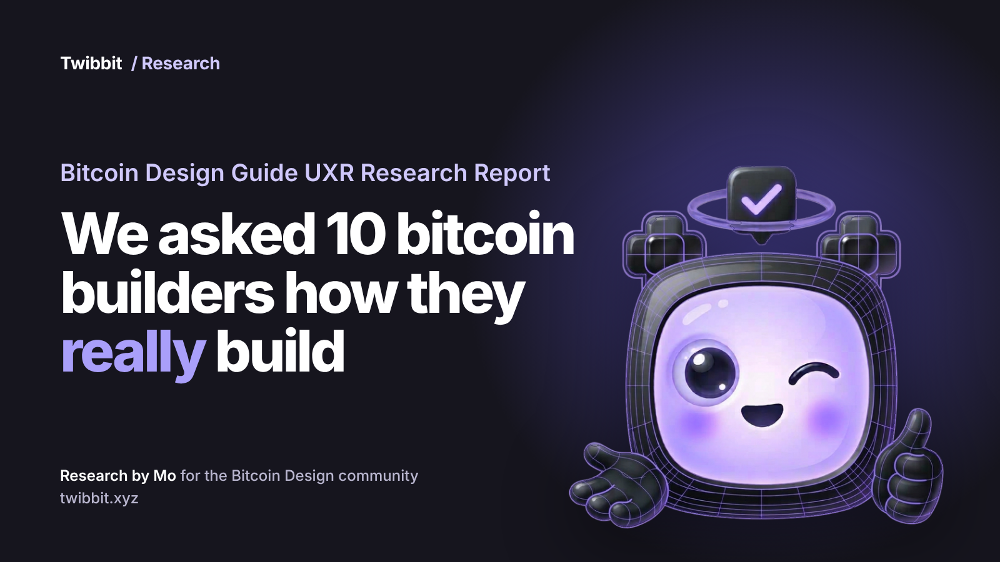

# We asked 10 bitcoin builders how they really build

*Bitcoin Design Guide UXR Research Report*

We connected with the Open Source bitcoin builder community to find the answers to three questions:

1. How are bitcoin builders of today really building using AI?
2. How do they make UX design decisions?
3. What are the Jobs to be done of a resource that would be genuinely valuable?

The only way to do this was to actually sit across the table and speak to real builders and that’s exactly what we did.

A moment during the interviews that really stood out was with a developer based in SF. He mentioned that he just builds a prototype, then gets up from his desk, walks over to someone in the co-working space, shows them the prototype and iterates. This developer conducting live in person feedback while building was very impressive. This real time loop between development and real human feedback is essential in UX design and it was wonderful to hear his story.

This report is for you, the builder ecosystem. It is a transparent overview of all the interviews which we conducted. It aims to tell a real story of what is happening today out in the wild, there are no assumptions just real stories.

Let’s dive in!

Research by Mogashni, for the Bitcoin Design Community, supported by Spiral.

## This report is where Twibbit comes from.

Nine in ten builders asked for the same thing: a skill or an agent their AI can connect to. That is what Twibbit is being built to be, right now. The tier 1 jobs in chapter 9 are its first brief: follow bitcoin UX best practices without making things up, show where a recommendation came from, and check what the agent built.

## In this report

1. Most builders no longer write the code
2. An idea that waited since 2012
3. The ground kept moving under them
4. Thirty wallets on one phone
5. Don't send me a design file
6. Seven in ten saw the AI get it wrong
7. Fewer humans in the room
8. Nine in ten want the same thing
9. Jobs to be done: tiers 1 to 3
10. Where do we go from here?
11. AI-powered UX design
12. Thank you

## 1. Most builders no longer write the code

> “I don't write code anymore, but I direct.”
>
> — Builder 9

Every single person that we interviewed uses AI to help write code. What was interesting was that the builder themselves was more of a director who essentially directs and simply reviews the code. Quite a few of the people we spoke had a skill file or a set of skill files, which they used on repeat.

More than 50% of the people shared directly/indirectly that design decisions are actually being made either by AI or by the builder themselves.

A few of the people we spoke to were using either Buzz.xyz or Berd.xyz in their development process. Very few of the builders that we spoke with started from a user perspective. That would have been approximately 20% of the interviews that started from a user-first perspective.

From a researcher's perspective, we see a strong pull towards a builder who is essentially orchestrating different agents to build his product. Works primarily solo or in a small core team, who builds and ships fast.

### In their own words

> “I'm the sole designer slash developer slash everything, I guess.”
>
> — Builder 4

> “I see myself as much more of an orchestrator.”
>
> — Builder 1

> “I'll say, discuss only, hold off on implementation, for example, to make sure it doesn't actually start implementing”
>
> — Builder 3

> “for front-end stuff, which is just, ‘I'm not good at it. I don't know what I'm doing,’ um, it has been incredibly helpful”
>
> — Builder 6

> “Because I'm still kind of new into implementing things, it's actually a lot better for me to use the agents to access different things or to help do different things.”
>
> — Builder 8

### What the numbers say

- **10 of 10** use AI to help write code.
- *All 9 builders covered let agents write most or all of the code and direct and review it. Builder 6 was not asked about his day-to-day process.*
- **6 of 10** use portable skill or instruction files.
- **6 of 10** make UX decisions without a UX specialist.
- **5 of 10** orchestrate beyond one coding CLI.
- **3 of 10** use Buzz.xyz or Berd.xyz (Builder 1, Builder 2, Builder 8).
- **2 of 10** start from vision, goals or users first (Builder 9, Builder 10), which is 20%.

But when builders build, they're always building from an idea or a need or a purpose. Where does that come from? That's what we dive into next.

## 2. An idea that waited since 2012

> “I've had that idea since 2012.”
>
> — Builder 8

When we asked many of the builders why they started building, as well as where the ideas came from, a small percentage of them mentioned that they start from a vision, goals, or the needs of their users.

Another person that we interviewed said that it was something that he built because he actually needed to use it himself and it simply didn't exist in the market.

Another person had carried the idea for many years and now with the advancements in AI, it empowered her to start building it herself. In that same category, 2 out of the 10 people said outright that their project would not exist if they did not have AI to support them in building it.

### In their own words

> “I just want to use it as a tool because the mission is to get good bitcoin UX out into people's hands.”
>
> — Builder 9

> “I built this, um, for my own sake, and then I thought, you know, maybe this is useful for more people.”
>
> — Builder 4

> “I always wanted to kind of have ownership of what I was building.”
>
> — Builder 8

> “from a lot of experience doing graphic design over the years and all that.”
>
> — Builder 2

> “Everybody starts out not knowing things.”
>
> — Builder 6

### What the numbers say

- **2 of 10** start from vision, goals or users first (Builder 9, Builder 10).
- **1 of 10** built it for their own need first (Builder 4).
- **2 of 10** said outright that the project would not exist without AI (Builder 4, Builder 9).
- *Where ideas come from was asked fully of 2 builders and partly of 4, so this section rests on a few voices.*

A builder has had the idea for years, but what do they actually do when they actually start building in an AI-powered environment? When they start, what actually stands in their way and what roadblocks do they face?

## 3. The ground kept moving under them

> “We were designing for the wrong goals”
>
> — Builder 6

What pushed many builders to start to look for UX help for UX design decisions was essentially the underlying technology setting limits on what they could design, in some cases the technology was changing, so they needed to look for inspiration or design solutions. This was about 60% of the people that we spoke to.

Another builder that we spoke to mentioned that when the team aligned with new project goals, their whole UX then needed to pivot. That's what caused them to then start to look into UX design.

### In their own words

> “I was aware that I would go in with a design for a protocol and an implementation that is changing.”
>
> — Builder 9

> “I still kind of underestimated it a little bit, how complex it actually is”
>
> — Builder 9

> “And after a while, it got quite complex, and the UI just exploded.”
>
> — Builder 4

### What the numbers say

- **6 of 10** said the underlying technology set limits on what they could design, or changed under them.

The builder has already started building, and much of what they are building is dependent on bitcoin protocols. This is because those protocols limit in many ways, the UX design on the frontend. How do builders actually get past these limits?

## 4. Thirty wallets on one phone

> “I have a ton of wallets, maybe, oh my god, maybe 30 wallets installed on my phone”
>
> — Builder 3

One of the very clear threads that ran through the interviews was that builders are taking design input and getting UX ideas simply by looking at what other best-in-class products are doing.

Some builders will have a couple of wallets downloaded on their phone, and then they'll look for design practices that these wallets are doing. They'll take bits and pieces of those design practices and implement that into whatever they are building.

### In their own words

> “We just kind of steal the best ideas and integrate it into our own app.”
>
> — Builder 3

> “I think it's valuable to go seek someone else's opinion”
>
> — Builder 3

> “And then I do a one-on-one 15-minute test session.”
>
> — Builder 9

### What the numbers say

- **4 of 10** clearly look at what other products do (Builder 3, Builder 9, Builder 4), and 3 more do it more lightly (Builder 2, Builder 8, Builder 10).
- **3 of 10** download various wallets and screenshot the user flow (Builder 3, Builder 9).
- **6 of 10** get, or want, human feedback on their designs.

We've seen that builders search for answers by looking at best practices of other wallets, as well as benchmarking their current UX design against that. But how do they actually search for these answers?

## 5. Don't send me a design file

> “Don't send me a Figma because I can't go through 700 pages of your Figma and I don't know how to navigate. But if you ship a PR, I can deploy it right away.”
>
> — Builder 10

Builders right now in 2026 are building fast, but they're not just building fast. They're building lightning fast. Builder 10 puts it this way: “it definitely allowed you to validate ideas much faster.” One of the builders we spoke with said they are not expecting to receive a Figma file from a designer with various pages for them to look through and approve. They'd prefer a PR to be submitted, which they can review and immediately approve or suggest changes to.

Some are directing their AI to look at the [Bitcoin Design Guide](https://bitcoin.design/). Even simple things which might be underestimated, such as the hierarchy of copy, which is a big part of UX design, is something that one builder mentioned was super helpful for them when using the Vibe Design UX skill file. One builder said, “the most value I got out of it is from the copy itself” and “the information hierarchy was great.”

What was also interesting is that many of the builders that we spoke with, approximately 40% of them, would put together a working prototype. That working prototype would be put together using AI, and then they would then do what we refer to as guerrilla user testing and iterate quickly thereafter.

### In their own words

> “Basically anybody can ship a prototype, and then we would stress-test it.”
>
> — Builder 10

> “I did tell Hermes or GLM, whichever one I call a person, to use the bitcoin design skill or something.”
>
> — Builder 8

> “I'm trying to make the Bitcoin Design Guide real.”
>
> — Builder 9

### What the numbers say

- **4 of 10** put together a working prototype with AI (Builder 2, Builder 3, Builder 10).
- **2 of 10** told their AI to use the Bitcoin Design Guide (Builder 8, Builder 10).
- **3 of 10** used the guide before and do not now (Builder 4, Builder 8, Builder 10).
- **1 of 10** uses it in a current build (Builder 9).

We see that the build process is simply going at lightning speed, powered by AI. However is there a price to pay for this speed that is involved? What are some of the situations or bottlenecks that builders are finding themselves experiencing as a result?

## 6. Seven in ten saw the AI get it wrong

> “Sometimes it just made up, hallucinated and I had to give it the documentation to see how it was supposed to build it”
>
> — Builder 4

However, there is still a price that most builders have had to pay for incorporating AI into their build process, these are some of the things that they mentioned.

Approximately 70% had an output which AI produced which was either made up completely wrong or misaligned with their input.

50% said that the bottleneck in their flow right now is having a human review the output of the agent.

50% of people were also going for an alternative route where they were getting the agent or different agentic models to review the output of the work.

40% said that they needed the UX and the copy that came out of AI to be further polished by a human.

### In their own words

> “You can get as many agents in the loop as you want, but at some point there has to be a human reviewer. And that's the biggest limitation.”
>
> — Builder 7

> “And for UI, it's basically useless.”
>
> — Builder 9

> “We added in a button and we forgot to add a dark mode variant to the button. So when the user goes to dark mode, the button isn't going to be readable.”
>
> — Builder 1

> “We can't close the loop. It's really hard to get an agent to see the iPhone simulator and to poke around in it, and to iterate on its own, rather than us having to provide the feedback that this text is covering the button, or the button's covering the text”
>
> — Builder 3

> “No one wants to read AI-generated text. I'd rather write something myself that's very brief and human, rather than just having it splurge out endless amounts of stuff that no one wants to read.”
>
> — Builder 9

### What the numbers say

- **7 of 10** had AI output that was made up, wrong or misaligned. (Builder 4, Builder 6, Builder 9).
- **5 of 10** say human review is now the bottleneck (Builder 1, Builder 3, Builder 7, Builder 9, Builder 10).
- **5 of 10** have one agent or model review another's work (Builder 1, Builder 3, Builder 4, Builder 10, and Builder 9 more weakly).
- **4 of 10** needed AI-generated UX or copy polished by a human (Builder 3, Builder 9, Builder 10).

So now that we know that there is a price to pay for the speed that AI provides, perhaps you are wondering about the human element?

## 7. Fewer humans in the room

> “Teams are shrinking because we no longer need that many developers.”
>
> — Builder 10

In this section, we dive into how the role of a builder is changing in 2026 and how AI has changed the way that they build. One of the builders that we spoke to said that the size of teams is simply shrinking with all of the abilities that AI is now able to do. A few of the builders that we spoke to predicted that the size of teams will shrink. With the number of humans in the process being reduced, AI agents are taking on a large part of what humans would otherwise do.

One person was concerned that the human connection is fading in the product development process. One maintainer raised AI slop. One of the builders mentioned that one of the things that he now enjoys is actually not having to interact with people and just being able to not have to find a designer who can match the exact design aesthetic that he was going for.

A couple of the other builders mentioned that their project simply would not exist if they were not able to build it with AI, and they were just so struck by how much AI had done.

### In their own words

> “Here's the roles that I think are going to collapse together. I think it's the product manager, the designer, the front-end engineer and maybe even the back-end engineer.”
>
> — Builder 1

> “Human connection is a little bit fading away in my experience between the people.”
>
> — Builder 10

> “Because the biggest multiplier for me, force multiplier, is not having to interact with people and having context and figuring out which designer has the best aesthetic that matches what you're trying to get at.”
>
> — Builder 2

> “I would never get this project off the ground without AI.”
>
> — Builder 4

> “I wouldn't be able to do this at all, this project without AI.”
>
> — Builder 9

### What the numbers say

- **3 of 10** say roles collapse, teams shrink, or the designer hand-off is skipped (Builder 1, Builder 4, Builder 10).
- **2 of 10** say the project would not exist without AI (Builder 4, Builder 9).
- **1 of 10** raised AI slop (Builder 10).

And yet building with AI also comes with its challenges so how are builders bridging these challenges? What resource could we, as a Bitcoin Design Community provide to builders to help bridge these challenges?

## 8. Nine in ten want the same thing

> “I would need some very easy entry point”
>
> — Builder 9

One of the goals of the research project was to find out what we could build as a Bitcoin Design Community as UX resource that would be of value to builders of today.

We will build a resource based on real needs, real stories and real workflows. That's a lot of reals in there! Well you get the point.

Now, as we round up this research report, we see that nine out of the ten builders asked for a skill or an agent their AI can connect to. The tenth person mentioned it only loosely, in the context of front-end work.

They want referencing too so if a specific design practice is suggested, they want to know where that design practice being referenced from. Is it being referenced from another wallet? If yes which wallet is it being referenced from?

These tended to be the main signals that came out of the research. As the research lead of this project, I would like to say that I am super grateful for all of the people who took their time and effort to be interviewed.

We will end this report with the jobs to be done that the AI-powered UX resource would need to provide to builders to be of value to them.

### In their own words

> “You have this one entry point and then maybe you end up with the copywriter skill or the accessibility review skill or the website marketing design skill or some other skill, right?”
>
> — Builder 9

> “The AI had kind of hidden, unspoken assumptions about what it used in its review that were misleading to me.”
>
> — Builder 9

> “It'll be good for it to start comparing and contrasting and giving me the best case scenario UI-wise.”
>
> — Builder 2

> “I like an answer that comes from first principles.”
>
> — Builder 7

## 9. Jobs to be done: tiers 1 to 3

The jobs to be done that the AI-powered UX resource would need to provide to builders to be of value to them.

### Tier 1

- **9 of 10** I need my coding agent to follow bitcoin UX best practices without making things up or me writing the instructions myself.
- **5 of 10** I need to see how other wallets handle a flow next to my design without installing them and taking screenshots by hand.
- **5 of 10** I need to check what my agent built against a named standard without reviewing every screen myself.
- **6 of 10** I need to know where a design recommendation came from without guessing what the AI compared it against.

### Tier 2

- **4 of 10** I need to design for protocol and hardware limits, such as multi-sig without starting from zero because nothing covers them.
- **3 of 10** I need a ready-made skill set without writing and maintaining instruction files myself.
- **3 of 10** I need AI help on my project without sending sensitive material to a cloud I don't control.

### Tier 3

- **2 of 10** I need the tool to ask whether I'm protecting an existing product or starting fresh without assuming it's a new build.
- **2 of 10** I need small suggestions for one screen or one pull request without the whole flow being redesigned.
- **2 of 10** I need to see which part of the Design Guide shaped a result without taking it on trust.

## 10. Where do we go from here?

- **Done:** Stage one was conducting the research interviews.
- **Done:** Stage two was processing the research interviews to get a high-level overview.
- **To do:** Stage three is going to be building out a product vision and MVP spec.
- **To do:** Stage four is going to be building out that MVP itself and getting it out into the ecosystem.
- **To do:** The final stage is going to be iterating on that based off of the feedback that we're getting from builders, going into projects, and helping them to get involved in their builder process.

## 11. AI-powered UX design

> “Maybe there is an agent personality that you can add to Buzz. That is kind of, “I am the UX guardian” in a sense.”
>
> — Builder 1

Here's what the builders are doing from a high level:

1. They have an idea.
2. They tell an AI agent what to build.
3. Their AI writes the code.
4. They steer and check it.
5. They look at how other apps can do it.
6. They get something working quickly and show someone.
7. They iterate based on that feedback, and then they ship.

We believe that the future of UX design is going to be design principles which are implemented into the builder's UX flow. We believe that this implementation is going to happen in the form of a skill file or in the form of an agent that has that. The agent would be trusted with tried-and-tested processes, UX processes, which are done on repeat.

What we are also seeing is that when we spoke to the builders, 60% of the builders are making UX decisions without a UX designer. The only opportunity for the practice of UX itself to be injected elegantly and skillfully into the process of developers is for it to meet them right now, where they builders are at.

If we extrapolate into the future, one would imagine that a developer essentially begins their build process, consults with their UX skill file or agent, continues the build process, then essentially does a human review.

There is another opportunity where there is a Buzz channel where builders can be invited into this Buzz channel. There will be a UX agent in the Buzz channel, but there will also be a UX designer in the channel.

The project will enter into the Buzz channel request a UX review. The UX agent will do the initial review. After the initial review is done by the agent, there will be a human who will do a UX review. Two different UX designers could create two different UX review skills and the project would go through 2 agents and one human to keep the review robust.

There will be a merge then of the review done by the agent as well as the human, and that will then serve as an output to the builder. The builder can choose the output to be either a PDF, a Google document, or even as quick as submitting a PR on the project's GitHub repository.

We believe that going in and implementing Twibbit into open-source bitcoin projects and really seeing how projects are using it, supporting them, and showing them that their feedback is valued is going to be a fundamental step in ensuring that this brings real value to the ecosystem. We remain very optimistic. Just after having spoken to builders, there's a lot of positive feedback, and we'll be able to give the UX design principles in the Bitcoin Design Guide a place in the development process. Very exciting times ahead!

## 12. Thank you

As the research lead of this project, I would like to say that I am super grateful for all the people.

Every single person we spoke to, was excited and open and honest, and ready to share their knowledge and share their build process.

This is what makes building Open Source bitcoin so fun and such a lovely place to work in. This openness of sharing knowledge is what helps the ecosystem to be robust.

Last but not least thank you to Spiral for believing in the importance of this research to [Mat Balez](https://x.com/matbalez) for his gentle guidance in strategy, to [Conor Okus](https://x.com/conorokus) for always being supportive.

Then to Aditya from Summer of Bitcoin and Elizabeth who contributed.

---

**Twibbit** is an open-source UX agent for bitcoin builders, built in public. Follow along and join the waitlist at [twibbit.xyz](https://twibbit.xyz).

Research by Mogashni, for the Bitcoin Design Community, supported by Spiral.
